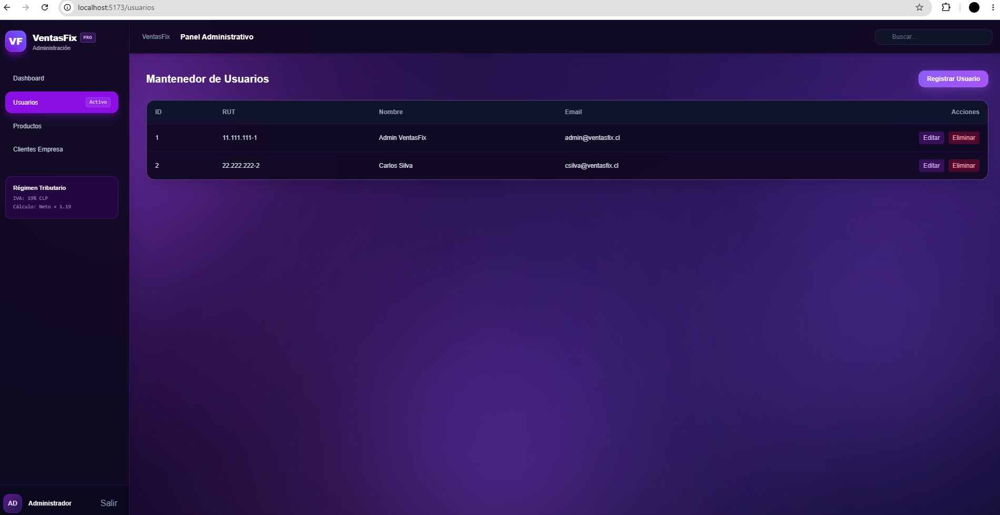
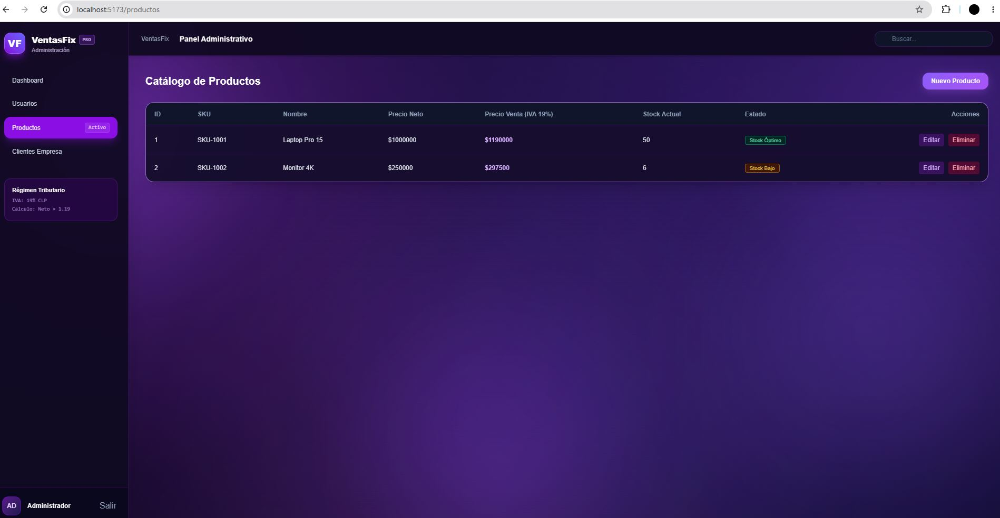
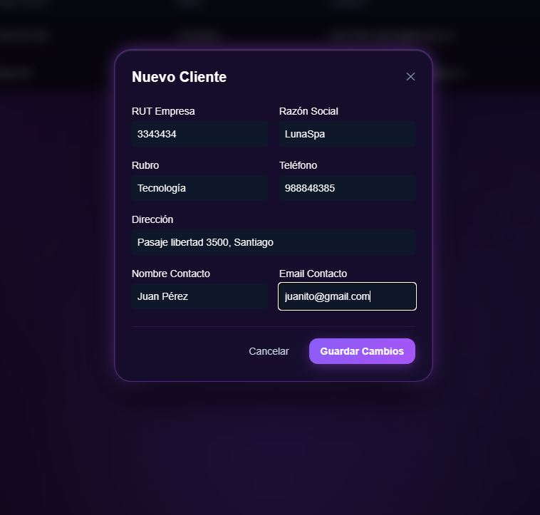
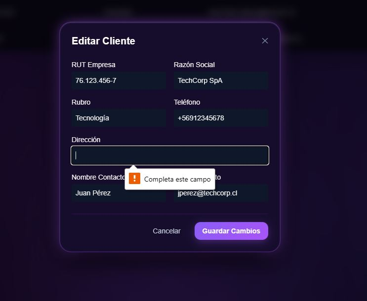
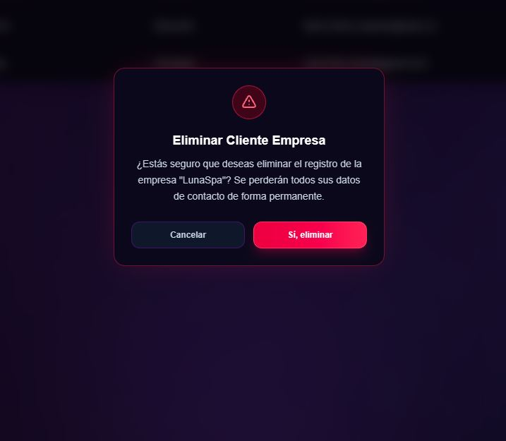

<div align="center">
  
# 🚀 VentasFix PRO
**Sistema de Gestión Comercial y Control de Inventarios (Backoffice)**

[](#)
[](#)
[](#)
[](#)
[](#)
[](#)

</div>

---

## 📌 ¿En qué consiste y qué problema soluciona?

**VentasFix** nace de la necesidad de modernizar y centralizar los flujos operativos de gestión comercial. Muchas empresas lidian con información fragmentada (hojas de cálculo esparcidas, descontrol de acceso de usuarios y descuadres de inventario). 

VentasFix soluciona esto proporcionando un **Panel de Administración (Backoffice) Integral** que permite:
- **Seguridad Corporativa:** Gestión estricta de usuarios administrativos restringidos bajo dominios institucionales (`@ventasfix.cl`) con autenticación JWT de alto grado (TLS simulado y encriptación BCrypt).
- **Control Fiscal y de Inventarios Automático:** Mantenedor de productos que calcula de forma sistémica el IVA (19%) sobre precios netos y evalúa niveles de stock (Óptimo, Bajo, Crítico) en tiempo real, evitando quiebres de inventario sin intervención humana.
- **Directorio B2B Centralizado:** Registro ordenado de clientes empresa (personas jurídicas) con validaciones para contactos, RUT, dirección y rubro, optimizando las áreas de ventas corporativas.

Todo esto bajo un diseño de vanguardia denominado **"Electric Iris"**, basado en micro-animaciones, componentes *Glassmorphism* (superficies translúcidas, desenfoque y halos luminosos) y una paleta oscura de muy alto contraste para mejorar la ergonomía visual del usuario.

---

## 🏗️ Arquitectura y Tecnologías

El proyecto sigue una arquitectura **Cliente-Servidor Desacoplada**, permitiendo total independencia entre el Frontend y el Backend, comunicándose exclusivamente a través de una **API RESTful**.

### 🎨 Frontend (Capa de Presentación)
- **React 19 & Vite 5:** Motor hiper-rápido de renderizado y compilación de HMR (Hot Module Replacement).
- **Tailwind CSS v4:** Framework de utilidades configurado como motor interno de Vite para estructurar las mallas y utilidades visuales responsivas.
- **Axios & React Router DOM:** Manejo del enrutamiento de vistas y despachador de peticiones HTTP (con interceptores automáticos de seguridad para inyectar el Bearer Token).
- **Vitest & React Testing Library:** Ecosistema para pruebas unitarias de componentes aislados (`Login`, `DataTable`).

### ⚙️ Backend (Capa de Negocio y Datos)
- **Java 21 & Spring Boot 3.x:** Framework empresarial que gestiona de manera robusta la lógica transaccional y la inyección de dependencias.
- **Spring Security & JWT (JSON Web Tokens):** Filtro `OncePerRequestFilter` para interceptar cada petición HTTP, validar la integridad del token y conceder los permisos.
- **Spring Data JPA & Hibernate:** ORM encargado de mapear las entidades y modelos de dominio hacia tablas relacionales.
- **MySQL 8:** Base de datos robusta para la persistencia transaccional de todos los mantenedores y métricas.
- **JUnit 5 & Mockito:** Suite de pruebas unitarias enfocada en probar servicios aislados simulando los repositorios de datos.

---

## 📁 Estructura del Proyecto

```text
VentasFix/
├── backend/                  # SERVIDOR JAVA SPRING BOOT
│   ├── src/main/java/com/ventasfix/
│   │   ├── config/           # SecurityConfig.java, DataSeeder.java, Filtros JWT
│   │   ├── controllers/      # Controladores REST (Auth, Dashboard, Crud)
│   │   ├── dto/              # Objetos de Transferencia de Datos y validaciones (@NotBlank)
│   │   ├── models/           # Entidades JPA (Usuario, Producto, Cliente)
│   │   ├── repositories/     # Interfaces Repository de JPA
│   │   ├── services/         # Lógica de Negocio y reglas de la empresa (Ej. IVA 19%)
│   │   └── utils/            # JWT Utils, decodificadores y ayudantes
│   └── pom.xml               # Dependencias de Maven
│
├── frontend/                 # INTERFAZ REACT WEB (VITE)
│   ├── src/
│   │   ├── components/       # Componentes visuales genéricos (DataTable, FormModal, Sidebar)
│   │   ├── context/          # AuthContext (Estado global de sesión)
│   │   ├── pages/            # Vistas enrutadas (Login, Dashboard, Mantenedores)
│   │   ├── services/         # Cliente API Base (Axios) con Interceptores
│   │   ├── index.css         # Archivo raíz con la paleta de colores y variables Tailwind
│   │   └── App.jsx           # Rutas principales y protectores de vista (PrivateRoutes)
│   ├── package.json          # Dependencias de NPM
│   └── vite.config.js        # Configuración de servidor de desarrollo y plugins (Tailwind)
│
└── start-dev.bat             # Script autómata de inicialización (Windows)
```

---

## 🔧 Componentes e Implementaciones Destacadas

### 1. Autogeneración de SKUs (Reglas del Negocio)
El sistema evita los cuellos de botella en la creación de productos. Al mandar el comando de persistencia, el backend guarda primero temporalmente, captura el `ID autoincremental` de MySQL y genera inmediatamente un SKU final inmutable bajo la nomenclatura `SKU-XXXX`, delegando el control lógico al servidor.

### 2. Tablas Inteligentes (`DataTable.jsx` y `ConfirmModal.jsx`)
Un componente React agnóstico y altamente reutilizable, que toma un objeto JSON dinámico para generar columnas y renderizados. Además, se creó un modal de eliminación centralizado (`ConfirmModal`) que lee directamente la fila enfocada para preguntar al usuario explícitamente: *"¿Estás seguro de que deseas eliminar el producto Laptop?"* (Personalizando el mensaje).

### 3. Paneles de Métrica y Análisis de Stock (`Dashboard.jsx`)
El sistema extrae los datos puros, pero mediante procesamiento dinámico del lado del cliente evalúa `Stock Mínimo`, `Stock Bajo` y `Stock Actual` para clasificar las alertas de riesgo y pintarlas de colores en la interfaz, optimizando la compra de existencias.

### 4. Data Seeder
Un `CommandLineRunner` embebido en Spring Boot evalúa si la base de datos MySQL local está vacía al iniciar. Si no hay datos, procede a llenar registros base (usuarios administrativos, tecnología e información de empresas), agilizando brutalmente el trabajo en un nuevo entorno de desarrollo.

---

## 🧪 Pruebas Unitarias y API (Postman)

El proyecto cuenta con un plan de pruebas robusto para asegurar la calidad de todas las capas del aplicativo:

- **Pruebas Unitarias Backend:** Se utilizaron `JUnit 5` y `Mockito` para validar la lógica de negocio aislada (Ej. cálculo del IVA, restricciones de registro) en la capa de servicios (`UsuarioServiceTest` y `ProductoServiceTest`), simulando (mocking) la respuesta de los repositorios JPA sin alterar la base de datos real.
- **Pruebas Unitarias Frontend:** Se configuró `Vitest` y `React Testing Library` (RTL) para validar el renderizado condicional, la funcionalidad de los componentes estructurales (como el `DataTable`) y las validaciones de los formularios (`Login`).
- **Pruebas de Integración (Postman):** Se incluye una colección de pruebas en la carpeta `pruebas_postman` que valida de manera exhaustiva todos los endpoints REST (Controladores) probando códigos de estado esperados (`200 OK`, `201 Created`, `204 No Content` y respuestas de error `400/401`) e inyección de token JWT.

---

## ▶️ Cómo ejecutar la aplicación localmente

La arquitectura desacoplada requiere iniciar el servidor y la interfaz por separado, sin embargo, hemos simplificado el proceso:

### Opción 1: Ejecución en 1-Clic (Recomendado)
Hemos provisto un script inteligente en la raíz del proyecto para desarrolladores en Windows.
1. Haz doble clic en el archivo `start-dev.bat`.
2. Este script abrirá automáticamente dos terminales independientes, levantando Java y Node.js en paralelo.

### Opción 2: Ejecución Manual
Asegúrate de que **MySQL** esté corriendo localmente en el puerto `3306` con una base de datos vacía llamada `ventasfix` (credenciales por defecto: `root` / `admin123`).

**1. Levantar el Servidor (Backend):**
Abre una terminal en la carpeta `backend` y ejecuta el envoltorio de Maven (Maven Wrapper):
```bash
# Windows
.\mvnw.cmd spring-boot:run

# Linux/Mac
./mvnw spring-boot:run
```
*(Nota: El servidor arrancará en el puerto `8080` y el `DataSeeder` inyectará los datos base automáticamente).*

**2. Levantar la Interfaz (Frontend):**
Abre una **nueva** terminal en la carpeta `frontend` y ejecuta:
```bash
npm install
npm run dev
```
Accede en tu navegador al enlace provisto (usualmente `http://localhost:5173`) e inicia sesión con las credenciales de prueba: `admin@ventasfix.cl` / `admin123`.

---

## 🖼️ Evidencias de Ejecución (Capturas)

A continuación se demuestran las vistas visuales y flujos que constatan el funcionamiento exitoso del proyecto final bajo el estilo paramétrico *Electric Iris*.

### 1. Pantalla de Acceso (Login)


### 2. Panel de Control (Dashboard & Alertas de Inventario)


### 3. Mantenedor de Usuarios Administrativos


### 4. Mantenedor de Productos (Con IVA 19% Sistémico y Autogeneración SKU)


### 5. Directorio de Clientes Empresa


### 6. Modal Genérico Glassmorphic (Registro)


### 7. Flujo de Modificación (Editar)


### 8. Ventana de Confirmación Dinámica (Eliminar)



