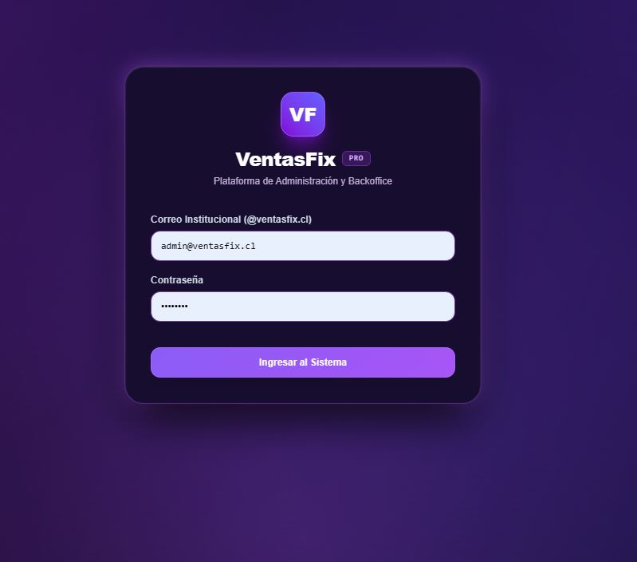
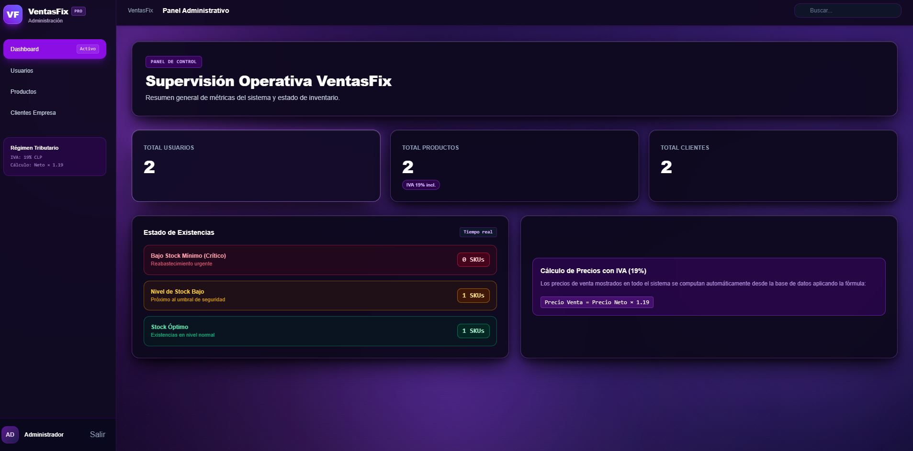
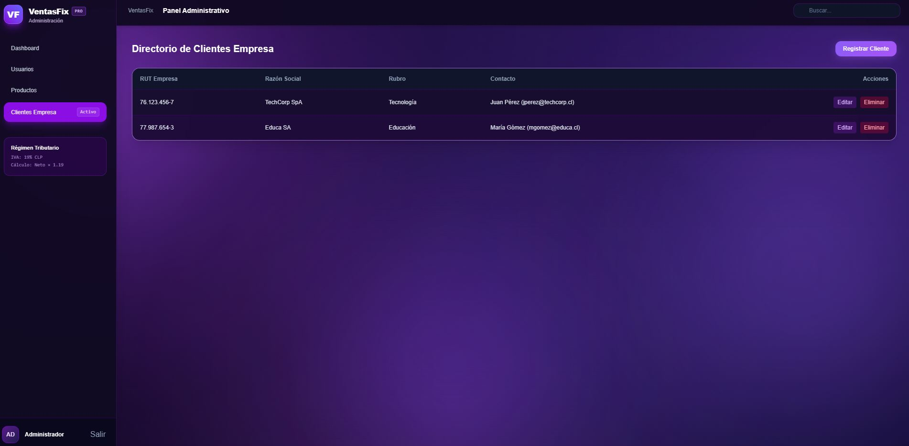

<div align="center">
  
# 🚀 VentasFix PRO
**Sistema de Gestión Comercial y Control de Inventarios (Backoffice)**

[](#)
[](#)
[](#)
[](#)
[](#)
[](#)
[](#)
[](#)
[](#)

</div>

---

## 🌐 Acceso a la Aplicación en Producción

La plataforma se encuentra desplegada y asegurada con certificado SSL/TLS en la nube de **Oracle Cloud Infrastructure (OCI)**:

* **URL Oficial de Acceso:** [https://ventasfix.duckdns.org](https://ventasfix.duckdns.org)
* **Acceso alternativo por IP:** `http://155.181.151.237` (Redirige automáticamente a HTTPS)

### 🔑 Credenciales Maestras de Acceso (Administrador)
| Campo | Valor |
|---|---|
| **Correo Electrónico (Username)** | `admin@ventasfix.cl` |
| **Contraseña** | `admin123` |

> [!NOTE]
> Al iniciar la aplicación en un entorno nuevo, el componente `DataSeeder` precarga automáticamente el usuario administrador inicial junto con un catálogo completo de productos y clientes de prueba.

---

## 📌 ¿En qué consiste y qué problema soluciona?

**VentasFix** nace de la necesidad de modernizar y centralizar los flujos operativos de gestión comercial. Muchas empresas lidian con información fragmentada (hojas de cálculo esparcidas, descontrol de acceso de usuarios y descuadres de inventario). 

VentasFix soluciona esto proporcionando un **Panel de Administración (Backoffice) Integral** que permite:
- **Seguridad Corporativa:** Gestión estricta de usuarios administrativos restringidos bajo dominios institucionales (`@ventasfix.cl`) con autenticación JWT de alto grado (TLS simulado y encriptación BCrypt).
- **Control Fiscal y de Inventarios Automático:** Mantenedor de productos que calcula de forma sistémica el IVA (19%) sobre precios netos y evalúa niveles de stock (Óptimo, Bajo, Crítico) en tiempo real, evitando quiebres de inventario sin intervención humana.
- **Directorio B2B Centralizado:** Registro ordenado de clientes empresa (personas jurídicas) con validaciones para contactos, RUT, dirección y rubro, optimizando las áreas de ventas corporativas.

Todo esto bajo un diseño de vanguardia denominado **"Electric Iris"**, basado en micro-animaciones, componentes *Glassmorphism* (superficies translúcidas, desenfoque y halos luminosos) y una paleta oscura de muy alto contraste para mejorar la ergonomía visual del usuario.

---

## 🏗️ Arquitectura y Tecnologías

El proyecto sigue una arquitectura **Cliente-Servidor Desacoplada**, permitiendo total independencia entre el Frontend y el Backend, comunicándose exclusivamente a través de una **API RESTful**.

### 🎨 Frontend (Capa de Presentación)
- **React 19 & Vite 5:** Motor hiper-rápido de renderizado y compilación de HMR (Hot Module Replacement).
- **Tailwind CSS v4:** Framework de utilidades configurado como motor interno de Vite para estructurar las mallas y utilidades visuales responsivas.
- **Axios & React Router DOM:** Manejo del enrutamiento de vistas y despachador de peticiones HTTP (con interceptores automáticos de seguridad para inyectar el Bearer Token y redireccionar al login en caso de expiración 401/403).
- **Vitest & React Testing Library:** Ecosistema para pruebas unitarias de componentes aislados (`Login`, `DataTable`).

### ⚙️ Backend (Capa de Negocio y Datos)
- **Java 21 & Spring Boot 3.x:** Framework empresarial que gestiona de manera robusta la lógica transaccional y la inyección de dependencias.
- **Spring Security & JWT (JSON Web Tokens):** Filtro `OncePerRequestFilter` para interceptar cada petición HTTP, validar la integridad del token y conceder los permisos.
- **Spring Data JPA & Hibernate:** ORM encargado de mapear las entidades y modelos de dominio hacia tablas relacionales.
- **MySQL 8:** Base de datos robusta para la persistencia transaccional de todos los mantenedores y métricas.
- **JUnit 5 & Mockito:** Suite de pruebas unitarias enfocada en probar servicios aislados simulando los repositorios de datos.

### 🛡️ Infraestructura Cloud & Seguridad
- **Oracle Cloud Infrastructure (OCI):** Máquina virtual de cómputo en la región `sa-santiago-1`.
- **Nginx Web Server & Reverse Proxy:** Servidor perimetral que recibe tráfico en puertos 80 y 443, gestiona el fallback de SPA para React (`try_files`) y enruta internamente las llamadas `/api/` hacia el backend Spring Boot.
- **Certbot & Let's Encrypt:** Certificados SSL/TLS gratuitos emitidos vía desafío ACME HTTP-01 con renovación automática.
- **DuckDNS:** Enrutamiento de nombres de dominio dinámico (DDNS) vinculado a la IP pública elástica/efímera de OCI.
- **Docker & Docker Compose:** Contenedorización multi-etapa (*multi-stage builds*) para frontend, backend y base de datos con políticas de reinicio y healthchecks.

---

## 📁 Estructura del Proyecto

```text
VentasFix/
├── backend/                  # SERVIDOR JAVA SPRING BOOT
│   ├── src/main/java/com/ventasfix/
│   │   ├── config/           # SecurityConfig.java, DataSeeder.java, GlobalExceptionHandler.java
│   │   ├── controllers/      # Controladores REST (Auth, Dashboard, Crud)
│   │   ├── dto/              # Objetos de Transferencia de Datos y validaciones (@NotBlank, @NotNull)
│   │   ├── models/           # Entidades JPA (Usuario, Producto, Cliente)
│   │   ├── repositories/     # Interfaces Repository de JPA
│   │   ├── services/         # Lógica de Negocio y reglas de la empresa (IVA 19%, SKU autogenerado)
│   │   └── security/         # JwtUtil, JwtAuthenticationFilter, UserDetailsServiceImpl
│   ├── Dockerfile            # Multi-stage build: Maven + Eclipse Temurin JRE 21 (usuario no-root)
│   └── pom.xml               # Dependencias de Maven
│
├── frontend/                 # INTERFAZ REACT WEB (VITE)
│   ├── src/
│   │   ├── components/       # Componentes visuales genéricos (DataTable, FormModal, ConfirmModal, Layout)
│   │   ├── context/          # AuthContext (Estado global de sesión JWT)
│   │   ├── pages/            # Vistas enrutadas (Login, Dashboard, Usuarios, Productos, Clientes)
│   │   ├── services/         # Cliente API (Axios con interceptor de autorización y refresco)
│   │   ├── index.css         # Paleta de colores Electric Iris y Tailwind v4
│   │   └── App.jsx           # Rutas principales y protectores de vista (ProtectedRoute)
│   ├── Dockerfile            # Multi-stage build: Node 20 Alpine + Nginx Alpine
│   ├── nginx.conf            # Configuración Nginx: SSL/TLS, compresión Gzip, proxy inverso /api
│   ├── package.json          # Dependencias de NPM
│   └── vite.config.js        # Configuración de servidor Vite y plugins
│
├── docker-compose.yml        # Orquestación de servicios (db, backend, frontend) con volúmenes y redes
├── .env.example              # Plantilla de variables de entorno para producción
└── start-dev.bat             # Script de inicialización automatizada en Windows local
```

---

## 🔧 Componentes e Implementaciones Destacadas

### 1. Autogeneración de SKUs (Reglas del Negocio)
El sistema evita cuellos de botella en la creación de productos. Al mandar el comando de persistencia, el servicio backend valida la unicidad, calcula los márgenes impositivos y genera de forma consistente el identificador único `SKU-XXXX`, delegando el control lógico estricto al servidor.

### 2. Tablas Inteligentes (`DataTable.jsx` y `ConfirmModal.jsx`)
Un componente React agnóstico y altamente reutilizable que recibe un arreglo de columnas dinámicas y datos en JSON para generar visualizaciones tabulares responsivas. Además, incluye un modal de confirmación centralizado (`ConfirmModal`) que lee el registro seleccionado para solicitar confirmación explícita antes de cualquier eliminación (`DELETE`).

### 3. Paneles de Métrica y Análisis de Stock (`Dashboard.jsx`)
El sistema consume el endpoint `/api/dashboard/stats` para computar los totales de usuarios, productos y clientes. Adicionalmente, evalúa en tiempo real `Stock Mínimo`, `Stock Bajo` y `Stock Actual` para clasificar las alertas de riesgo y pintarlas con indicadores cromáticos en la interfaz.

### 4. Precarga de Datos Automática (`DataSeeder.java`)
Un `CommandLineRunner` embebido en Spring Boot evalúa si la base de datos MySQL está vacía al iniciar. Si no hay datos, procede a poblar registros base con contraseñas cifradas en BCrypt, catálogo de productos y clientes de prueba.

### 5. Cifrado y Redirección Segura SSL/TLS
Nginx implementa una directiva de redirección 301 para forzar todo el tráfico HTTP al puerto HTTPS (443). Se configuraron suites de cifrado modernas (TLS 1.2 y 1.3) con soporte para certificados emitidos por Let's Encrypt montados como volúmenes de solo lectura en Docker.

---

## 🧪 Pruebas Unitarias y API (Postman)

El proyecto cuenta con un plan de pruebas integral para asegurar la calidad de todas las capas del aplicativo:

- **Pruebas Unitarias Backend:** Se utilizaron `JUnit 5` y `Mockito` para validar la lógica de negocio aislada (cálculo de IVA del 19%, autogeneración de SKU, unicidad de correos `@ventasfix.cl`) en la capa de servicios (`UsuarioServiceTest` y `ProductoServiceTest`), simulando el comportamiento de repositorios sin impactar la base de datos.
- **Pruebas Unitarias Frontend:** Se configuró `Vitest` y `React Testing Library` (RTL) para validar el renderizado condicional, los componentes estructurales (`DataTable`) y las validaciones de los formularios (`Login`).
- **Pruebas de Integración (Postman):** Se incluye una colección en `pruebas_postman` que valida exhaustivamente todos los endpoints REST probando códigos de estado HTTP rigurosos (`200 OK`, `201 Created`, `204 No Content` y respuestas `400/401`) junto con inyección de cabeceras `Authorization: Bearer <token>`.

---

## ▶️ Cómo ejecutar la aplicación localmente

La arquitectura desacoplada permite levantar el entorno localmente de forma inmediata:

### Opción 1: Ejecución en 1-Clic (Recomendado para Windows)
1. Asegúrate de tener MySQL corriendo localmente (puerto `3306`).
2. Haz doble clic en el archivo `start-dev.bat`.
3. El script abrirá automáticamente dos consolas independientes levantando el backend Spring Boot (puerto `8080`) y el frontend Vite (puerto `5173`).

### Opción 2: Ejecución Manual
**1. Backend (Spring Boot):**
```bash
cd backend
# En Windows:
.\mvnw.cmd spring-boot:run

# En Linux / Mac:
./mvnw spring-boot:run
```

**2. Frontend (React / Vite):**
```bash
cd frontend
npm install
npm run dev
```

Ingresa a `http://localhost:5173` e inicia sesión con:
- **Correo:** `admin@ventasfix.cl`
- **Contraseña:** `admin123`

---

## ☁️ Guía de Despliegue en la Nube (Oracle Cloud Infrastructure - OCI)

El proyecto está 100% contenerizado y optimizado para **Oracle Cloud Infrastructure (OCI)** en instancias de cómputo Ubuntu mediante **Docker Compose**.

### Arquitectura de Despliegue en OCI

```text
               [ Internet / Clientes ]
                         │
                         │ HTTPS (Puerto 443) / HTTP (Puerto 80 -> Redirect 301)
                         ▼
        [ OCI Compute Instance: ventasfix-productos ]
        [ Dominio: https://ventasfix.duckdns.org    ]
                         │
        ┌────────────────┴────────────────────────────────────────┐
        │  Docker Compose Network (ventasfix-network)             │
        │                                                         │
        │  ├── [ ventasfix-frontend ] (Nginx Alpine + SSL)        │
        │  │   ├── Escucha: 80 (HTTP) & 443 (HTTPS)               │
        │  │   ├── Montaje: /etc/letsencrypt (Certificados SSL)   │
        │  │   ├── Entrega: SPA React 19 optimizada               │
        │  │   └── Proxy: /api/* -> http://backend:8080/api/*     │
        │  │                                                      │
        │  ├── [ ventasfix-backend ] (Spring Boot 3 / Java 21)    │
        │  │   ├── Escucha: 8080                                  │
        │  │   ├── Healthcheck: /api/health                       │
        │  │   └── Conexión ORM a base de datos                   │
        │  │                                                      │
        │  └── [ ventasfix-db ] (MySQL 8.0.45)                    │
        │      ├── Escucha: 3306                                  │
        │      └── Volumen persistente: mysql_data                │
        └─────────────────────────────────────────────────────────┘
```

---

### Paso a Paso para Desplegar en OCI

#### 1. Configurar Reglas de Firewall en OCI Console y Ubuntu
1. **En la consola web de OCI:**
   - Ve a `Networking` ➔ `Virtual Cloud Networks` ➔ Tu VCN ➔ `Security Lists` ➔ `Default Security List`.
   - Agrega en **Ingress Rules**:
     - `0.0.0.0/0` | `TCP` | Puerto `80` (HTTP)
     - `0.0.0.0/0` | `TCP` | Puerto `443` (HTTPS)

2. **En el sistema operativo Ubuntu (SSH):**
   > [!IMPORTANT]
   > Las imágenes Ubuntu de OCI traen una regla por defecto en la posición 5 que rechaza todo el tráfico (`REJECT`). Es indispensable insertar las reglas al principio (`-I INPUT 1`) para que tengan efecto:
   ```bash
   sudo iptables -I INPUT 1 -p tcp --dport 80 -j ACCEPT
   sudo iptables -I INPUT 1 -p tcp --dport 443 -j ACCEPT
   sudo iptables -I INPUT 1 -p tcp --dport 8080 -j ACCEPT
   sudo netfilter-persistent save
   ```

#### 2. Instalar Docker, Docker Compose y Certbot en Ubuntu
```bash
sudo apt update && sudo apt install -y docker.io docker-compose git certbot
sudo systemctl enable --now docker
sudo usermod -aG docker $USER
newgrp docker
```

#### 3. Emitir el Certificado SSL con Certbot (Let's Encrypt)
Con Docker temporalmente detenido (para liberar el puerto 80):
```bash
sudo certbot certonly --standalone -d ventasfix.duckdns.org
```

#### 4. Clonar y Desplegar el Proyecto con Docker Compose
```bash
cd ~
git clone <URL_DE_TU_REPOSITORIO_GIT>
cd VentasFix

# Crear el archivo de variables de entorno
cp .env.example .env

# Construir y levantar todos los contenedores en segundo plano
docker-compose up -d --build
```

#### 5. Verificación de Contenedores y Salud
```bash
# Ver los contenedores activos
docker-compose ps

# Probar la salud del backend
curl http://localhost:8080/api/health
```

#### 6. ¡Acceso Seguro en Producción!
Ingresa directamente en tu navegador a:
👉 **[https://ventasfix.duckdns.org](https://ventasfix.duckdns.org)**

---

## 👥 Equipo de Desarrollo y Rúbrica
Proyecto desarrollado bajo estándares estrictos de ingeniería de software:
- **Patrón MVC** en Backend con separación estricta por capas (`controllers`, `services`, `repositories`, `models`, `dto`).
- **Componentes Modulares Reutilizables** en Frontend (`DataTable`, `FormModal`, `ConfirmModal`, `Layout`).
- **Seguridad perimetral y de transporte:** JWT Bearer Token, cifrado BCrypt y SSL/TLS Let's Encrypt.
- **Códigos de estado HTTP rigurosos:** `200 OK`, `201 Created`, `204 No Content`, `400 Bad Request`, `401 Unauthorized`, `403 Forbidden`, `404 Not Found`.

---

## 🖼️ Evidencias de Ejecución (Capturas)

A continuación se demuestran las vistas visuales y flujos que constatan el funcionamiento exitoso del proyecto final bajo el estilo paramétrico *Electric Iris*.

### 1. Pantalla de Acceso (Login)


### 2. Panel de Control (Dashboard & Alertas de Inventario)


### 3. Mantenedor de Usuarios Administrativos


### 4. Mantenedor de Productos (Con IVA 19% Sistémico y Autogeneración SKU)


### 5. Directorio de Clientes Empresa


### 6. Modal Genérico Glassmorphic (Registro)


### 7. Flujo de Modificación (Editar)


### 8. Ventana de Confirmación Dinámica (Eliminar)


